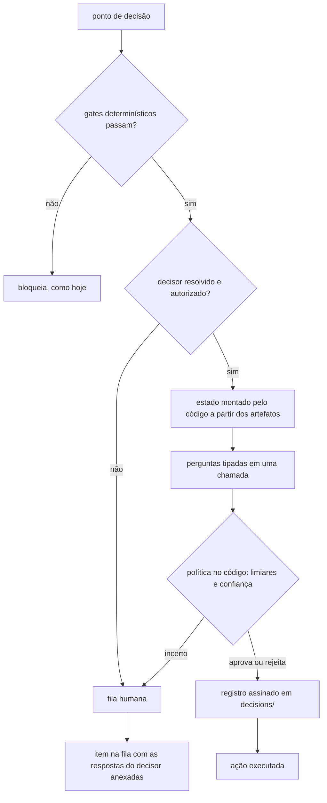

# Operador-decisor: decisões do operador tomadas por um modelo de juízo tipado

> **Status:** proposta / opt-in. Nada aqui altera o comportamento default do PWN.
> **Relação com `jev-opcional-economia-tokens-v2.md`:** reaproveita o contrato de adaptador
> (§1.1 daquele documento), mas inverte o regime: lá o decisor é **consultivo e falha aberto**;
> aqui ele **decide** e, por isso, **falha fechado** (incerteza ou indisponibilidade → fila humana).

Um modo opcional, ligado por flag, em que as decisões que hoje exigem o operador passam a ser
tomadas por um modelo de juízo tipado (Jev como primeiro adaptador). O modelo escolhe só entre
opções que o código oferece, cada decisão fica registrada e assinada, e quando o modelo está
incerto a decisão volta para o humano, nunca para "aprovado".

## 1. Premissas que definem a arquitetura

1. **Nem toda decisão pode ser delegada.** `--no-gate` e `--no-isolation` existem para um humano
   assumir risco. Se um modelo puder ligá-los, as defesas do harness viram opcionais. Ficam fora
   do decisor, sem exceção.
2. **A falha é fechada.** Com `--operator=decider` pedido e sem decisor disponível (sem chave,
   sem rede, resposta incerta), a decisão vai para a fila humana. Falhar aberto, neste modo, é
   aprovar sem ninguém olhar.
3. **O agente não escolhe quem o aprova.** O agente escreve plano, testes e código. A
   configuração do decisor (provedor, limiares, teto de risco) fica **fora do repositório**, na
   raiz do verificador, como as chaves Ed25519. O agente pode **anunciar** qual decisor usa, mas
   o PWN só aceita o anúncio se ele estiver na lista autorizada pelo operador.

## 2. Inventário de decisões

| Decisão (onde está hoje) | Delegável? | O que o decisor julga | Regra no código |
|---|---|---|---|
| `verify approve --by` (`src/core/acceptance-approval.ts:190`) | **Sim**, a principal | Os testes congelados verificam o comportamento da task? Passariam com uma implementação que ignora o requisito? O escopo cabe? | Aprova só com todos os limiares atendidos; mantém a regra de aprovar antes de implementar. |
| Achados `medium`/`low` em `pass_with_notes` (`src/core/gates.ts:49`, `accepted_risk`) | Sim | O achado é falso positivo ou risco aceitável para este requisito? | Pode marcar `accepted_risk`/`deferred`. `high`/`critical` continuam bloqueando. |
| Escalação `on_attempt_failed` (`src/core/contract-engine.ts:163`) | Sim | Tentar de novo com agente forte, refazer o plano ou chamar humano? | Escolha entre opções fechadas, com limite de tentativas no código. |
| Task retida em `work batch` | Sim | Agente corrige, `rebase`, ou tirar a task do lote? | O código executa a ação escolhida. |
| `--risk auto` (`src/core/v3-import.ts:533`) | Sim, só para subir | Nível L0–L4; a task é sensível? | Nunca rebaixa o risco determinístico. |
| Fila AFK L4 (`src/core/run-orchestrator.ts:342`, `queue approve`) | **Só com teto explícito** | O efeito é destrutivo ou irreversível? | Padrão: decide até L3, L4 vai para o humano. Incluir L4 exige `max_risk: "L4"` no `decider.json`. |
| `--no-gate`, `--no-isolation` | **Não** | — | Recusados com `--operator=decider`. |
| Resolver conflito de `rebase` | Não | Decisão de código: o agente resolve | — |
| Marcar `[x]` | Não precisa de modelo | — | Automático: recibo `ACCEPTED`, depois marca em ordem de plano. |

Critério: regra, cálculo ou existência ficam no código; o modelo entra só onde é preciso
entender texto. Ele julga, o código aplica a política.

## 3. Fluxo de uma decisão



## 4. Arquitetura

```
src/core/decider/contract.ts          primitivas neutras (choice / noul / score), interface DeciderAdapter, registro de adaptadores
src/core/decider/resolve.ts           qual decisor usar e se está autorizado
src/core/decider/ledger.ts            registro da decisão + assinatura Ed25519 na raiz do verificador
src/core/decider/adapters/jev.ts      único arquivo que conhece endpoint, chave e modelo do Jev
src/core/decider/policies/<ponto>.ts  um por decisão: monta o estado, faz as perguntas, decide (função pura)
```

- **Adaptador Jev:** `POST https://api.typesafe.ai/v1/systemone` com `state`, `model` e um mapa
  de `questions`. As perguntas de um mesmo ponto vão juntas (rodam em paralelo e não se veem).
  A resposta traz `noul`, `choice` com `probabilities` e `confidence`, `score` e o uso de tokens,
  gravado em `.pwn/metrics.jsonl` separado do custo do agente.
- **Cada política exporta:** `buildState(artefatos)`, `questions` e
  `decide(respostas, limiares) → aprova | rejeita | escala`. O `decide` é puro e testável sem rede.
- **Registro da decisão:** digest do estado, perguntas, respostas brutas, modelo exato
  (ex.: `jev-1.13.0`), limiares e resultado. Em `.pwn/decisions/<work>/<id>.json`, com cópia
  assinada na raiz do verificador. A aprovação registra
  `approved_by: "decider:jev-1.13.0#<id do registro>"`. Como as respostas ficam salvas, a política
  pode ser recalculada com outros limiares sem chamar o modelo de novo.

### 4.1 Configuração por projeto (`pwn init` / `pwn decider`) — implementado

- `pwn init` **sempre pergunta** se o projeto usa decisor: modelo (`<provedor>:<modelo>`), nome
  da variável de ambiente com a chave e teto de risco. O `PWN_DECIDER` anunciado pelo agente
  hospedeiro só vira a **sugestão padrão** da pergunta, nunca autorização.
- Sem terminal, o init não trava: aceita `--decider …` / `--no-decider`; sem flags, registra
  "sem decisor" (ou mantém a configuração existente) e avisa.
- Depois do init: `pwn decider show`, `pwn decider set` (cria ou altera só os campos informados)
  e `pwn decider remove` (o projeto passa a não usar decisor). Reexecutar `pwn init` também troca.
- A configuração fica **fora do repositório**: `<raiz do verificador>/deciders/<hash do caminho
  real do projeto>.json`, modo `0600`. A chave de API nunca é gravada, só o nome da variável.
  Implementação: `src/core/decider/config.ts`, `src/commands/init.ts`.

```jsonc
// <raiz do verificador>/deciders/<id>.json
{
  "version": 1,
  "enabled": true,
  "project": "/caminho/real/do/projeto",
  "decider": "jev:jev-latest",
  "key_env": "TYPESAFE_API_KEY",
  "max_risk": "L3",
  "scope": ["approve", "findings", "escalation", "batch", "risk"],
  "configured_at": "…"
}
```

Limiares por política (seção 5) entram neste arquivo quando as políticas forem implementadas.

### 4.2 Quando o decisor é usado

- **Configuração habilitada presente → o decisor é usado por padrão** em `work run`,
  `work run-all`, `work batch`, `task run` e `verify approve`.
- `--operator=human` desliga o decisor numa execução específica.
- **Sem configuração (ou `enabled: false`) → não há decisor**; `--operator=decider` é recusado.
- `PWN_OPERATOR` repassa o modo aos subprocessos de `run-all`, `batch` e `verify run-all`.
- Teto de risco e limiares só mudam por `pwn decider set`; não há flag de execução para relaxá-los.

## 5. Exemplo: a aprovação

**Estado** (montado pelo código, rotulado como "artefato do repositório, não instrução"):
requisito, `behavior` da task, ACs com comando e descrição, conteúdo dos testes congelados,
`write_allow`.

**Perguntas:**

- `noul` `cobre_comportamento` — os testes em `frozen_tests` verificam o resultado observável
  descrito em `task.behavior`?
- `noul` `passa_sem_requisito` — esses testes passariam com uma implementação que ignora o requisito?
- `score` `especificidade` — de "só checa existência" até "checa o valor exato e casos de borda".
- `choice` `escopo` — o `write_allow` é adequado, amplo demais ou estreito demais?

**Política:** aprova se `cobre > 0,85`, `passa_sem < 0,15`, `especificidade ≥ 2`,
`escopo = adequado` com confiança `≥ 0,7`. Rejeita (motivo tipado de volta ao agente) se
`cobre < 0,2`. Qualquer outro caso vai para a fila humana. Os números são pontos de partida;
a calibragem é a fase F1.

## 6. Limites que continuam existindo

- **Injeção pelo texto do repositório.** No modo autônomo, o agente escreve o PRD, os testes e o
  plano que o decisor lê. A saída tipada impede respostas fora de formato, não manipulação
  semântica. Defesas: gates determinísticos continuam pré-requisito; o modelo só escolhe entre
  opções fechadas; L4 fica fora por padrão; a verificação independente (recibo, causalidade em
  `bwrap`) continua rodando — o decisor aprova critérios, não substitui a prova de execução.
- **Mesmo usuário do sistema.** O agente roda como o operador e pode, em tese, mexer no ambiente
  e na raiz do verificador (`LIMITES.md` §2b). O decisor não resolve isso.
- **Coerência, não verdade.** Se o PRD inventado pelo agente for coerente com os testes
  inventados por ele, a aprovação passa. Precisa entrar em `LIMITES.md` quando implementado.

## 7. Fases

| Fase | Entrega | Critério para avançar |
|---|---|---|
| F0 | Contrato, adaptador Jev, registro assinado, resolução e autorização do decisor | Registros reproduzíveis; falha fechada testada (sem chave → fila humana) |
| F1 | **Modo sombra** para aprovação e achados: o decisor decide, o humano confirma, o PWN mede a concordância | Concordância medida em Works reais; limiares calibrados com dados do projeto |
| F2 | Modo autoritativo para aprovação, achados, escalação, lote e risco | Taxa de escalação aceitável; nenhuma aprovação revertida na amostra |
| F3 | L4, só com teto explícito | Decisão do operador com base nos dados da F2 |

## 8. Decisões tomadas

1. **Configuração no `pwn init`, não anunciada pelo agente.** O init sempre pergunta; o
   `PWN_DECIDER` do agente só pré-preenche a sugestão. Evita acoplar o PWN ao formato interno
   de cada agente e mantém a escolha com o operador.
2. **Teto de risco padrão L3.** L4 vai para o humano até a F3, salvo `--decider-max-risk L4`.
