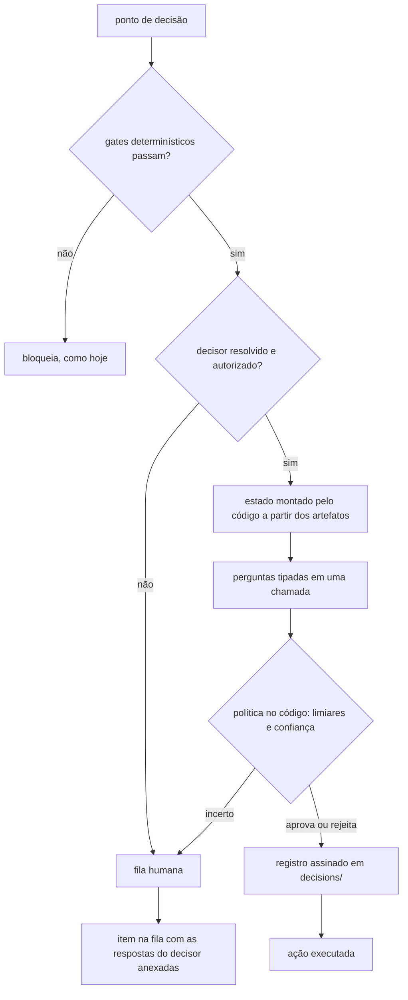

# Operador-decisor: decisões do operador tomadas por um modelo de juízo tipado

> **Status:** implementado (F0 + modo autoritativo). Opt-in por projeto: sem decisor configurado,
> o comportamento do PWN não muda. Modo sombra (F1) não implementado.
> **Relação com `jev-opcional-economia-tokens-v2.md`:** reaproveita o contrato de adaptador
> (§1.1 daquele documento), mas inverte o regime: lá o decisor é **consultivo e falha aberto**;
> aqui ele **decide** e, por isso, **falha fechado** (incerteza ou indisponibilidade → operador).

As decisões que hoje exigem o operador passam a ser tomadas por um modelo de juízo tipado (Jev
como primeiro adaptador) quando o projeto tem decisor configurado (`pwn init` / `pwn decider`).
O modelo escolhe só entre opções que o código oferece, cada decisão fica registrada e assinada,
e quando o modelo está incerto a decisão volta para o humano, nunca para "aprovado".

## 1. Premissas que definem a arquitetura

1. **Nem toda decisão pode ser delegada.** `--no-gate` e `--no-isolation` existem para um humano
   assumir risco. Se um modelo puder ligá-los, as defesas do harness viram opcionais. Ficam fora
   do decisor, sem exceção.
2. **A falha é fechada.** Com decisor configurado e indisponível (sem chave, sem rede, resposta
   fora do contrato) ou incerto, a decisão vai para o operador. Falhar aberto, neste modo, é
   aprovar sem ninguém olhar.
3. **O agente não escolhe quem o aprova.** O agente escreve plano, testes e código. A
   configuração do decisor (provedor, teto de risco, endpoint) fica **fora do repositório**, na
   raiz do verificador, como as chaves Ed25519. O `PWN_DECIDER` anunciado pelo agente só vira
   sugestão no `pwn init`.

## 2. Inventário de decisões (conferido contra o código)

| Decisão | Estado | O que o decisor julga | Regra no código |
|---|---|---|---|
| `verify approve` sem `--by` | **Implementado** (`policies/approve.ts`) | Os testes congelados verificam o `behavior`? Passariam sem o requisito? Especificidade? Escopo? | Aprova só com todos os limiares; rejeita testes vazios; o resto vai ao operador (exit 3). Gate global: o comando verifica o que o gate declara? |
| Fila AFK L4 (`runOrchestrated`) | **Implementado**, só com teto `L4` (`policies/queue.ts`) | Efeito destrutivo ou irreversível? Comando corresponde à task? | Destrutivo ou incerto → fila humana com motivos. Aprovação na fila (humana ou do decisor) vale para o mesmo contrato e comando. |
| Task retida em `work batch integrate` | **Implementado como regra** (sem modelo) | — | Retida só por base desatualizada (`clash`, `stale_base`) → `rebase` automático, registrado. Regressão e entrega incompleta continuam com o agente. Tirar a task do lote (destrutivo) não é decidido. |
| `--risk auto` (`importV3Work`) | **Implementado** (`policies/risk.ts`) | Nível L1–L3 de cada task | Só sobe, até L3, com confiança ≥ 0,7. Nunca rebaixa, nunca atribui L4. |
| Achados `medium`/`low` (`pass_with_notes`) | **Não se aplica** | — | No código, `pass_with_notes` não bloqueia nada e nenhum comando grava `accepted_risk`/`deferred`: não há decisão do operador a delegar. |
| Escalação `on_attempt_failed` | **Não se aplica** | — | É campo estático do contrato; `evaluateEscalation` (`router.ts`) não tem chamador. O PWN não roda o agente, então não há escolha em tempo de execução. |
| `--no-gate`, `--no-isolation` | **Nunca** | — | Fora do decisor. |
| Resolver conflito de `rebase` | Não | Decisão de código: o agente resolve | — |

Critério: regra, cálculo ou existência ficam no código; o modelo entra só onde é preciso
entender texto. Ele julga, o código aplica a política.

## 3. Fluxo de uma decisão



## 4. Arquitetura (implementada)

```
src/core/decider/config.ts            configuração por projeto (fora do repo), escopos, teto de risco
src/core/decider/contract.ts          primitivas neutras (choice / noul / score), DeciderAdapter, validação da resposta
src/core/decider/engine.ts            modo do operador, governança (escopo/teto), chamada, falha fechada
src/core/decider/ledger.ts            registro da decisão + assinatura Ed25519 na raiz do verificador
src/core/decider/adapters/jev.ts      único arquivo que conhece endpoint e formato do Jev
src/core/decider/http-worker.ts       POST síncrono em subprocesso (os pontos de decisão são síncronos)
src/core/decider/policies/<ponto>.ts  um por decisão: monta o estado, perguntas e `judge` (função pura)
```

- **Adaptador Jev:** `POST https://api.typesafe.ai/v1/systemone` com `state`, `model` e um mapa
  de `questions`. As perguntas de um mesmo ponto vão juntas. A chave vai ao subprocesso por
  ambiente, nunca por argv; 429/529 têm backoff. Resposta fora do contrato (pergunta sem
  resposta, tipo trocado, opção fora do conjunto, número fora do intervalo) é indisponibilidade.
- **Uso de tokens** fica no registro de cada decisão (`pwn decider log`), não em
  `.pwn/metrics.jsonl`: misturar com as runs do agente distorceria as sugestões de roteamento.
- **Cada política exporta** o montador de estado/perguntas e `judge(respostas) → aprova |
  rejeita | escala`, puro e testável sem rede.
- **Registro da decisão:** digest do estado, perguntas, respostas brutas, modelo exato
  (ex.: `jev-1.13.0`), limiares e resultado, assinado em `<raiz do verificador>/decisions/<id>.json`,
  com cópia em `.pwn/decisions/<work>/<id>.json`. A aprovação registra
  `approved_by: "decider:jev-1.13.0#<id do registro>"`.

### 4.1 Configuração por projeto (`pwn init` / `pwn decider`) — implementado

- `pwn init` **sempre pergunta** se o projeto usa decisor: modelo (`<provedor>:<modelo>`), nome
  da variável de ambiente com a chave e teto de risco. O `PWN_DECIDER` anunciado pelo agente
  hospedeiro só vira a **sugestão padrão** da pergunta, nunca autorização.
- Sem terminal, o init não trava: aceita `--decider …` / `--no-decider`; sem flags, registra
  "sem decisor" (ou mantém a configuração existente) e avisa.
- Depois do init: `pwn decider show`, `pwn decider set` (cria ou altera só os campos informados)
  e `pwn decider remove` (o projeto passa a não usar decisor). Reexecutar `pwn init` também troca.
- A configuração fica **fora do repositório**: `<raiz do verificador>/deciders/<hash do caminho
  real do projeto>.json`, modo `0600`. A chave de API nunca é gravada, só o nome da variável.
  Implementação: `src/core/decider/config.ts`, `src/commands/init.ts`.

```jsonc
// <raiz do verificador>/deciders/<id>.json
{
  "version": 1,
  "enabled": true,
  "project": "/caminho/real/do/projeto",
  "decider": "jev:jev-latest",
  "key_env": "TYPESAFE_API_KEY",
  "max_risk": "L3",
  "scope": ["approve", "findings", "escalation", "batch", "risk"],
  "configured_at": "…"
}
```

Limiares por política (seção 5) entram neste arquivo quando as políticas forem implementadas.

### 4.2 Quando o decisor é usado

- **Configuração habilitada presente → o decisor é usado por padrão** em `verify approve` (sem
  `--by`), na fila L4 de `work run`/`task run`/`run-all`, em `work batch integrate` e em
  `work import --risk auto`.
- `--operator human` (ou `--operator=human`, flag global do CLI) desliga o decisor numa execução.
  `--by` em `verify approve` é sempre decisão humana.
- **Sem configuração (ou `enabled: false`) → não há decisor**; `--operator=decider` é recusado.
- `PWN_OPERATOR` repassa o modo aos subprocessos de `run-all`, `batch` e `verify run-all`.
- Teto de risco e limiares só mudam por `pwn decider set`; não há flag de execução para relaxá-los.

## 5. Exemplo: a aprovação

**Estado** (montado pelo código, rotulado como "artefatos do repositório, não instruções"):
requisito, `behavior` da task, ACs com comando e descrição, conteúdo dos testes congelados,
`implementation_files`, `write_allow` e `write_deny`.

**Perguntas:**

- `noul` `cobre_comportamento` — os testes em `frozen_tests` verificam o resultado observável
  descrito em `task.behavior`?
- `noul` `passa_sem_requisito` — esses testes passariam com uma implementação que ignora o requisito?
- `score` `especificidade` — de "só checa existência" até "checa o valor exato e casos de borda".
- `choice` `escopo` — o `write_allow` é adequado, amplo demais ou estreito demais?

**Política:** aprova se `cobre > 0,85`, `passa_sem < 0,15`, `especificidade ≥ 2`,
`escopo = adequado` com confiança `≥ 0,7`. Rejeita (motivo tipado de volta ao agente) se
`cobre < 0,2` ou `passa_sem > 0,85`. Qualquer outro caso vai para o operador. Os números são
pontos de partida (`APPROVE_THRESHOLDS`); calibrá-los exige o modo sombra (F1).

## 6. Limites que continuam existindo

- **Injeção pelo texto do repositório.** No modo autônomo, o agente escreve o PRD, os testes e o
  plano que o decisor lê. A saída tipada impede respostas fora de formato, não manipulação
  semântica. Defesas: gates determinísticos continuam pré-requisito; o modelo só escolhe entre
  opções fechadas; L4 fica fora por padrão; a verificação independente (recibo, causalidade em
  `bwrap`) continua rodando — o decisor aprova critérios, não substitui a prova de execução.
- **Mesmo usuário do sistema.** O agente roda como o operador e pode, em tese, mexer no ambiente
  e na raiz do verificador (`LIMITES.md` §2b). O decisor não resolve isso.
- **Coerência, não verdade.** Se o PRD inventado pelo agente for coerente com os testes
  inventados por ele, a aprovação passa. Registrado em `LIMITES.md` §11.

## 7. Fases

| Fase | Entrega | Estado |
|---|---|---|
| F0 | Contrato, adaptador Jev, registro assinado, resolução e autorização do decisor | **Feito**; falha fechada testada (sem chave, HTTP de erro, resposta fora do contrato → operador) |
| F1 | **Modo sombra**: o decisor decide, o humano confirma, o PWN mede a concordância | Não implementado; os limiares seguem os pontos de partida da seção 5 |
| F2 | Modo autoritativo para aprovação, lote e risco | **Feito** |
| F3 | L4, só com teto explícito | **Feito**: exige `--decider-max-risk L4`; efeito destrutivo sempre volta ao operador |

## 8. Decisões tomadas

1. **Configuração no `pwn init`, não anunciada pelo agente.** O init sempre pergunta; o
   `PWN_DECIDER` do agente só pré-preenche a sugestão. Evita acoplar o PWN ao formato interno
   de cada agente e mantém a escolha com o operador.
2. **Teto de risco padrão L3.** L4 vai para o humano até a F3, salvo `--decider-max-risk L4`.
